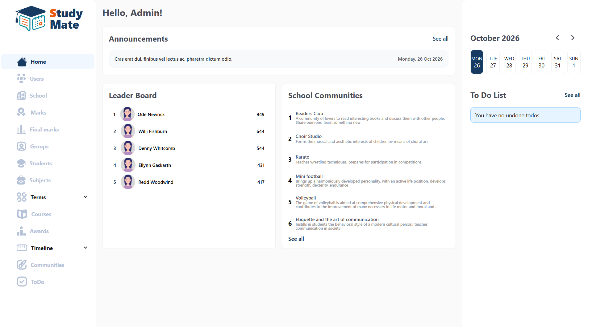
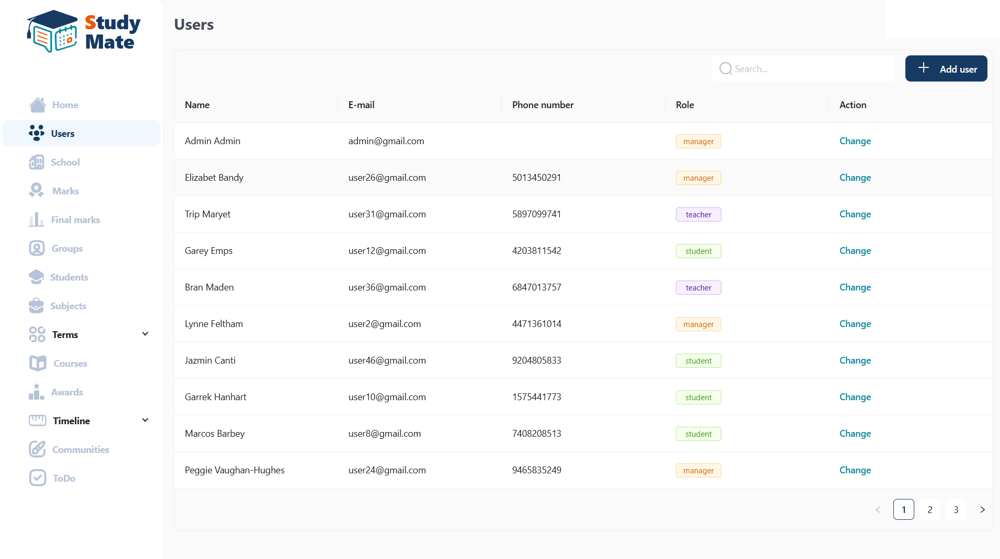
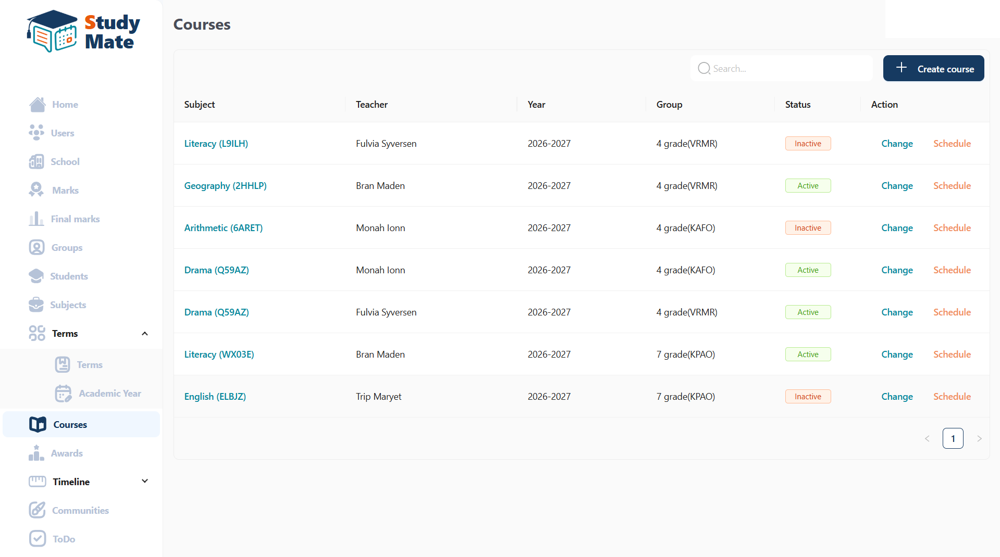
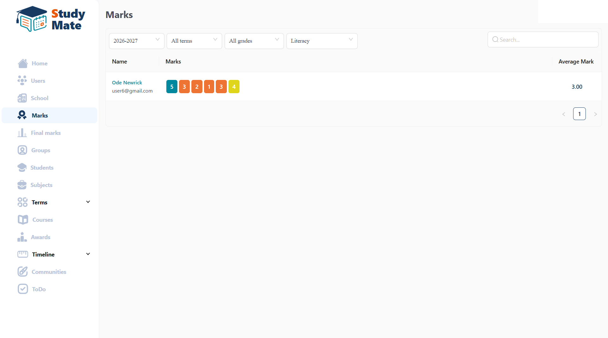
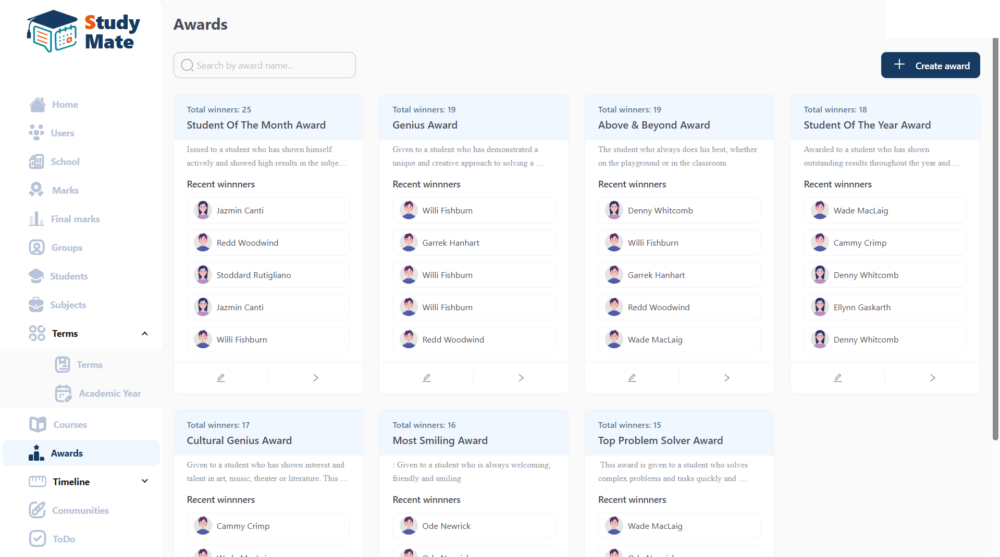
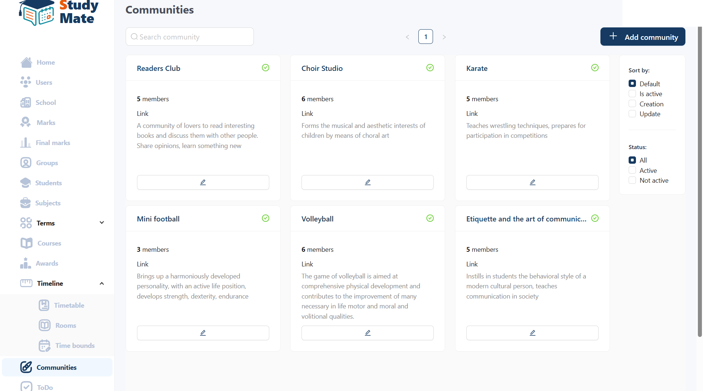

# StudyMate LMS

StudyMate is a full-stack learning management system for schools. It brings course delivery, assignments, grading, schedules, student groups, academic records, awards, announcements, communities, and personal task management into one platform.

## Developer

**Developed by Assylkhan Yeraliyev**

StudyMate combines product planning, a React/Redux frontend, a Django REST backend, database-backed school workflows, authentication, and deployment setup.

StudyMate was created to explore how one platform can make academic administration and everyday learning tasks easier for school managers, teachers, and students.

## Live demo

- **Application:** [studymate-yeraliyeeev.onrender.com](https://studymate-yeraliyeeev.onrender.com)
- **Source code:** [github.com/yeraliyeeev/studymate-lms](https://github.com/yeraliyeeev/studymate-lms)
- **Demo email:** `admin@gmail.com`
- **Demo password:** `admin`

The hosted account is read-only. Reviewers can explore manager workflows and sample data, but requests that would create, edit, or delete data are rejected by the API. The backend may take a short time to wake after inactivity on Render's free plan.

The deployment also refreshes the sample academic-year labels and term dates to the current school cycle, keeping the portfolio data visibly current.
The public demo school includes the complete grade range from grade 1 through grade 11.

## Features

- Role-based access for managers, teachers, and students
- School, user, grade, group, and subject administration
- Courses, enrolments, syllabuses, and assignments
- Assignment marks, term marks, and annual marks
- Timetables for students, teachers, groups, rooms, and courses
- School and course announcements with discussions
- Student awards, leaderboards, and public profiles
- Communities and memberships
- Personal to-do lists and dashboards
- JWT authentication and a REST API

## Technology

- **Frontend:** React 18, Redux Toolkit, React Router, Material UI, Ant Design
- **Backend:** Python, Django, Django REST Framework, Simple JWT
- **Database:** SQLite for local development; the architecture can be adapted to PostgreSQL
- **Tooling:** Docker and Docker Compose

## Quick start with Docker

1. Copy the environment template:

   ```bash
   cp backend/.env.example backend/src/.env
   ```

2. Build and start both services:

   ```bash
   docker compose up --build
   ```

3. Open the frontend at `http://localhost:3000`. The API is available at `http://localhost:8000/api/`.

## Local development

### Backend

```bash
cd backend
python -m venv .venv
source .venv/bin/activate
pip install -r requirements.txt
cp .env.example src/.env
python src/manage.py migrate
python src/manage.py seed_db
python src/manage.py runserver
```

### Frontend

```bash
cd frontend
npm ci
cp .env.example .env
npm start
```

## Configuration

Backend settings are read from `backend/src/.env`. Frontend API configuration is read from `REACT_APP_API_URL`; it defaults to `http://127.0.0.1:8000/` for local development.

Do not commit production secrets, uploaded media, local databases, or `.env` files.

## Deploy on Render

This repository includes a `render.yaml` Blueprint that provisions:

- A React static site
- A Django web service
- A PostgreSQL database

After pushing the repository to GitHub:

1. Sign in to Render with GitHub.
2. Select **New → Blueprint**.
3. Connect the `yeraliyeeev/studymate-lms` repository.
4. Keep the Blueprint path as `render.yaml`.
5. Review the three resources and select **Deploy Blueprint**.

The initial deployment runs migrations and safely creates demo data only when the database is empty. Subsequent deployments preserve the existing database.

The free backend service can take a short time to wake after inactivity. When both deployments succeed, add the frontend URL to the GitHub repository's **Website** field.

## Local demo account

After running `seed_db`, sign in locally with:

- Email: `admin@gmail.com`
- Password: `admin`

For production deployments, configure `DEMO_READ_ONLY_EMAIL`. The deployment command removes Django administrator privileges from that account, and API middleware blocks all data-changing requests made with its JWT access token.

## Architecture

```text
React + Redux Toolkit  →  Django REST API  →  PostgreSQL
        browser              Render             Render
```

JWT authentication connects the client to the API. Role-aware routes provide separate manager, teacher, and student workflows. The public portfolio account is additionally restricted to read-only requests on the server.

## Portfolio highlights

- Designed and developed a full-stack school management platform
- Modelled school workflows across three user roles
- Built a React single-page interface backed by a Django REST API
- Added JWT authentication, role-aware navigation, filtering, and pagination
- Deployed the frontend, API, and PostgreSQL database as a Render Blueprint
- Added server-side protection for a safe public demonstration

## Screenshots

| Dashboard and activity | Users and roles |
| --- | --- |
|  |  |

| Courses and enrolment | Academic marks |
| --- | --- |
|  |  |

| Awards and recognition | Student communities |
| --- | --- |
|  |  |

## Project structure

```text
backend/    Django REST API and application modules
frontend/   React single-page application
project/    Database schema reference files
```

## License and reuse

No open-source licence is included. Contact Assylkhan Yeraliyev before copying, redistributing, or reusing the code.
